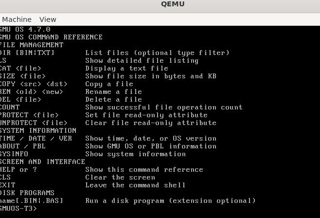
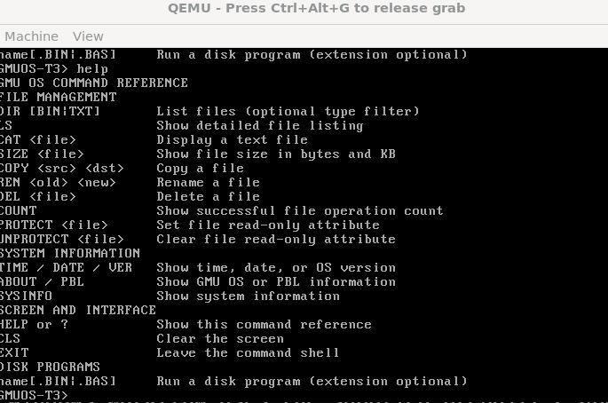
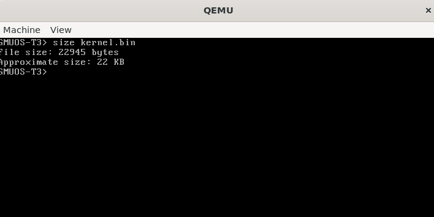
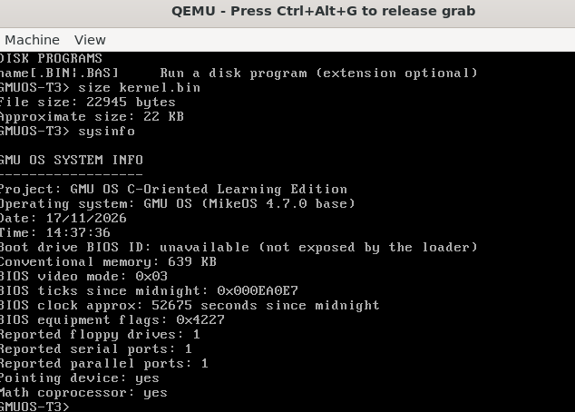

# GMU OS 0.1
### C-Oriented Operating System Learning Edition

A teaching-oriented operating system project developed for Operating Systems Project Based Learning at **GM University, Davanagere, Karnataka, India**.

GMU OS 0.1 is an educational derivative of **MikeOS 4.7.0**. It retains the original 16-bit x86 assembly bootloader and kernel architecture while introducing a documented C application interface, C-based utilities, and additional command-line features.

> **Important:** This project does not rewrite the original MikeOS kernel in C. Assembly remains responsible for the low-level boot and operating-system infrastructure. The GMU extension provides a C-oriented application development environment.

---

## Features

### Operating system and command-line extensions
- GMU OS branding and identity.
- Categorized `HELP` command.
- `?` shortcut for the help screen.
- Improved `SIZE` command with file size reporting in bytes and approximate KB.
- `COUNT` command for reporting the file-operation counter.
- Existing MikeOS command-line and application environment retained.

### C application development
- Documented C application interface under `c_src/`.
- GCC `-m16` based application build workflow.
- C-to-assembly entry bridge.
- OS service wrappers for screen output, keyboard input, date/time, speaker control, and system information.
- Prebuilt C utilities, including `GMUINFO.BIN` and `SYSINFO.BIN`.

### System information utilities
- OS and project identity.
- BIOS date and time.
- Conventional memory information.
- Video mode information.
- Available BIOS hardware information.

##64-bit UEFI Pendrive Boot & Hot-Plug USB Detection
Boots directly on bare-metal hardware from a FAT32 USB flash drive (`BOOT`) and dynamically scans, mounts, and reads newly inserted pendrives (`USB0:/`) via `refresh`, `usbinfo`, and `DIR` commands.

---

## Architecture

The project preserves the original MikeOS execution model:

```text
BIOS
 |
 v
16-bit Assembly Bootloader
 |
 v
MikeOS-compatible Kernel
 |
 v
OS API / Assembly Service Routines
 |
 v
Application loaded at 0x8000
 |
 v
GMU C Entry Bridge
 |
 v
C Application (gmu_main)
```

The C interface allows students familiar with C to develop applications while learning how software interacts with a low-level operating system.

See [Architecture Documentation](gmu_docs/ARCHITECTURE.md) for implementation details.

---

## Repository Structure

| Directory / File | Description |
|---|---|
| `source/` | Bootloader and operating-system kernel source |
| `programs/` | Original and additional application programs |
| `c_src/` | C headers, examples, build scripts, and prebuilt applications |
| `gmu_docs/` | GMU OS architecture and development documentation |
| `doc/` | Original MikeOS documentation and license |
| `disk_images/` | Disk image documentation and related files |
| `upstream_original/` | Preserved upstream files for comparison |
| `backups/` | Development-stage backups |
| `WEEK10_REPORT.md` | Week 10 implementation and testing report |
| `GMU_OS_VERIFICATION.txt` | Package verification record |

---

## Getting Started

### Requirements

For Linux / WSL:
- NASM
- GCC with `-m16` support
- GNU binutils
- QEMU
- Required disk-image utilities, including `dosfstools` and `mkisofs` or a compatible `genisoimage`
- Root privileges for the complete image-building workflow

For Windows:
- NASM
- ImDisk
- `dd` utility
- A compatible Windows build environment

### Build on Linux / WSL

Clone the repository and enter its directory:

```bash
git clone https://github.com/raveenachoudhary/GMU-OS-PBL.git
cd GMU-OS-PBL
```

Build the GMU OS image:

```bash
sudo ./build-gmu-linux.sh
```

The generated bootable image is:

```text
disk_images/gmuos.flp
```

To build the C applications separately:

```bash
./c_src/build-c-linux.sh
```

### Build on Windows

Run:

```bat
build-gmu-win.bat
```

The Windows workflow uses the supplied prebuilt C applications.

---

## Running in QEMU

After building the image, launch it using:

```bash
qemu-system-i386 -m 16 -drive file=disk_images/gmuos.flp,format=raw,if=floppy
```

At the GMU OS command prompt, try:

```text
HELP
?
SIZE KERNEL.BIN
COUNT
```

You can also explore the supplied C utilities, including `SYSINFO` and `GMUINFO.BIN`.

---
## Running on Real Hardware (64-bit UEFI Pendrive Boot)

GMU-OS 4.7.0 (64-bit UEFI Edition) can boot directly from a physical USB flash drive without an emulator:

1. **Prepare the Bootable Pendrive (`BOOT`):**
   - Format the USB drive as **FAT32** and copy the compiled 64-bit UEFI boot files onto it.
2. **Boot on Physical Hardware:**
   - Insert the pendrive, restart the PC, and open the UEFI Boot Menu (`F12`, `F9`, or `Esc`).
   - Select the USB device to launch the `GMU-OS>` shell.
3. **Detect & Access a Newly Inserted Pendrive (`USB0`):**
   - Plug in a second FAT32 pendrive while GMU-OS is running.
   - Run `refresh` to re-scan UEFI storage controllers, `usbinfo` to inspect capacity and filesystem details, and `DIR USB0:/` to browse files and directories.

## Screenshots

### GMU OS Boot Screen



### Categorized HELP Command



### SIZE Command



### System Information



### 64-Bit UEFI Pendrive Boot (`usbinfo`)


### New Pendrive Detection (`refresh`, `usbinfo`, and `DIR USB0:/`)


## Verification

The project includes a package verification record in `GMU_OS_VERIFICATION.txt`.

Recorded checks include:

- The verification record covers a 97-file package; the current Git repository tracks 117 files.
- Bootable floppy image size: 1,474,560 bytes.
- Boot signature: `55AA`.
- GMU OS branding detected in the image.
- MikeOS attribution files present.
- C application compilation tested with GCC `-m16` and GNU `ld`.

The Week 10 QEMU test report also records tests for `HELP`, `help`, `?`, `ver`, `date`, `COUNT`, `SIZE`, and unknown-command handling.

These records document the tests performed in the development environment; they are not a guarantee of compatibility with every machine or emulator.

- [x] **Bare-Metal UEFI USB Boot:** Verified `GMU-OS 4.7.0 (64-bit UEFI Edition)` booting from a 3.7 GB FAT32 `BOOT` pendrive on physical hardware.
- [x] **Dynamic Pendrive Detection:** Verified hot-plug discovery of a secondary 7.4 GB FAT32 pendrive (`USB0`) using `refresh`, `usbinfo`, and read/write directory listing (`DIR USB0:/`).

---

## Documentation

- [OS Architecture](gmu_docs/ARCHITECTURE.md)
- [C Application Development Guide](gmu_docs/C_DEVELOPMENT.md)
- [Suggested 10-Week Modification Roadmap](gmu_docs/WEEKLY_MODIFICATIONS.md)
- [Week 10 Implementation Report](WEEK10_REPORT.md)
- [Package Verification](GMU_OS_VERIFICATION.txt)
- [GMU OS Package Introduction](README-GMU-OS.TXT)

---

## Project Background

This project was developed as part of Operating Systems Project Based Learning at GM University.

The learning objective is to help students understand operating-system internals, assembly-based system infrastructure, application interfaces, and C-based systems programming through a small, modifiable operating system.

---

## Upstream Attribution and License

GMU OS 0.1 is based on **MikeOS 4.7.0**.

Original project: https://mikeos.sourceforge.net/

Copyright (C) 2006–2022 MikeOS Developers.

The original MikeOS license and attribution are retained in [`doc/LICENSE.TXT`](doc/LICENSE.TXT). Please read that license before redistributing the upstream-derived source or binaries.

GMU OS is an educational derivative. It is not an official MikeOS release, and the MikeOS name or contributors do not endorse this project.

---

**GMU OS 0.1 | Operating Systems Project Based Learning | GM University**
